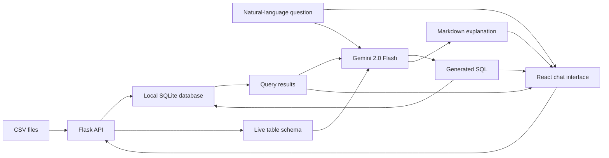

# DataChat AI

Ask questions about CSV data in plain English. DataChat AI loads one or more CSV files
into a local SQLite database, uses Google Gemini to translate a question into SQL, and
returns the generated query, its results, and a plain-language explanation.

> This is a local prototype. Use the included sample data or other non-sensitive data.
> Generated SQL is executed against the local SQLite database.

## What it does

- Uploads multiple CSV files and maps each file to a SQLite table.
- Builds a prompt from the live database schema.
- Uses Gemini 2.0 Flash to generate SQL for a natural-language question.
- Executes the query locally and displays the result as a table.
- Uses Gemini to turn the result into a concise Markdown explanation.
- Shows useful errors for missing data, invalid questions, empty results, and query
  failures.

## How it works



| Layer | Implementation |
| --- | --- |
| Frontend | React, Axios, React Markdown |
| API | Flask, Flask-CORS |
| Data loading | Pandas |
| Storage | Local SQLite database |
| Language model | Google Gemini 2.0 Flash |

## Run locally

### Prerequisites

- Python 3.8+
- Node.js and npm
- A Google Gemini API key

### 1. Clone the repository

```bash
git clone https://github.com/sakshii-shinde/DataChat_AI.git
cd DataChat_AI
```

### 2. Start the backend

```bash
cd backend
python3 -m venv .venv
source .venv/bin/activate
pip install -r requirements.txt
cp .env.example .env
```

Add your key to `backend/.env`:

```dotenv
GEMINI_API_KEY=your_gemini_api_key_here
```

Then start Flask:

```bash
python app.py
```

The API runs at `http://127.0.0.1:5000`.

### 3. Start the frontend

In a second terminal:

```bash
cd DataChat_AI/frontend
npm install
npm start
```

Open `http://localhost:3000`.

## Try it

Sample relational CSV files are included in `dummy_data_DataChat_AI/`. Upload the four
files from either sample-data directory, then try questions such as:

- What are the total sales?
- Which products sold the most units?
- What is the average order value?
- Show sales grouped by month.

Each response contains the SQL that Gemini generated, the returned rows, and a written
analysis. Showing the SQL makes the answer inspectable instead of hiding the model's
intermediate step.

## API

| Method | Route | Purpose |
| --- | --- | --- |
| `GET` | `/` | Health check |
| `POST` | `/upload/csv` | Load a CSV file into a SQLite table |
| `POST` | `/query` | Generate and execute SQL for a question |
| `POST` | `/remove/<filename>` | Remove the table created from a CSV file |

## Project structure

```text
DataChat_AI/
├── backend/
│   ├── app.py              # Flask routes and query flow
│   ├── database.py         # CSV-to-SQLite and schema operations
│   ├── gemini_service.py   # SQL generation and result explanation
│   ├── .env.example
│   └── requirements.txt
├── frontend/
│   └── src/                # React chat and upload UI
└── dummy_data_DataChat_AI/     # Two sample relational datasets
```

## Current scope

- CSV is the only supported input format.
- Data and the generated SQLite database stay on the machine running the backend, but
  questions, database schemas, and query results are sent to the configured Gemini API.
- The app is intended for local development; authentication and multi-user isolation are
  not implemented.
- Automated tests and a deployment configuration are not included yet.

## Status

Personal project built in January–February 2025.
